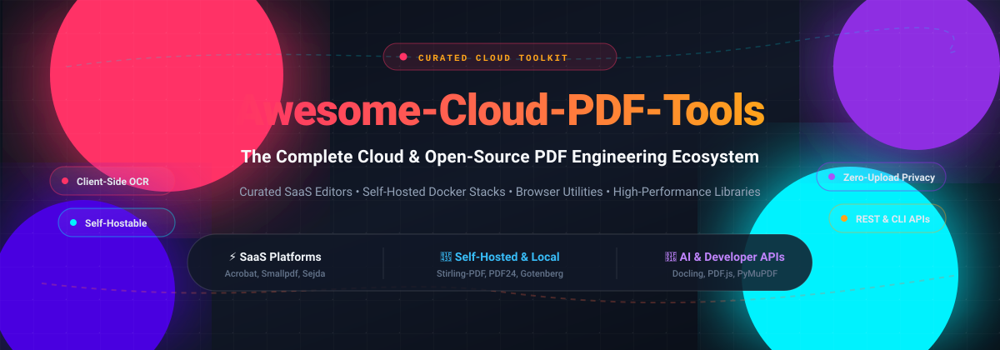

  

  
  
  
  
  

<h1 align="center">Awesome Cloud PDF Tools 📄☁️</h1>

<h3 align="center">Curated Directory of Cloud PDF SaaS Platforms, Self-Hosted Docker Toolkits &amp; High-Performance Document Engineering Libraries</h3>

  <em>Master browser-based PDF editing, zero-upload local privacy tools, client-side OCR, e-signatures, document parsing for LLMs/RAG, and self-hosted cloud alternatives to Adobe Acrobat.</em>

  <strong>Last updated: October 2026</strong> • <strong>Curated with ❤️ by <a href="https://github.com/ishandutta2007">Ishan Dutta</a> and community contributors</strong>

---

## 📌 Executive Summary &amp; Quick Intro

Welcome to **Awesome Cloud PDF Tools**—the comprehensive index and SEO-friendly knowledge hub for modern PDF workflows in the cloud and web browser. Whether you need a commercial **SaaS platform** for collaborative PDF editing and digital signing, a **100% free browser-based local utility**, or a self-hosted **Docker stack** to eliminate enterprise per-document subscription fees, this guide indexes the finest solutions across the ecosystem.

### 🌟 Key Categories Covered
- ⚡ **Commercial SaaS Suites:** Feature-rich cloud platforms with OCR, AI document assistants, forms, and compliant eSignatures.
- 🔒 **Privacy-Preserving Web Tools:** Browser-first utilities executing operations client-side via WebAssembly/HTML5 Canvas without server uploads.
- 🐳 **Self-Hosted Document Stacks:** Full-featured on-premise microservices and Docker containers (e.g. Stirling-PDF, Gotenberg) giving you 100% data sovereignty.
- 🛠️ **Developer Engines &amp; AI Parsers:** Core rendering (PDF.js), generative manipulation (pdf-lib, pdfcpu), and multimodal AI document extraction (Docling, PyMuPDF) for LLM pipelines.

---

## 📑 Table of Contents

- [📊 Sector Overview &amp; Market Dynamics](#-sector-overview--market-dynamics)
- [☁️ SaaS &amp; Hosted Platforms](#️-saas--hosted-platforms)
- [💻 Open-Source GitHub Projects](#-open-source-github-projects)
- [🤝 How to Contribute](#-how-to-contribute)
- [💖 Support &amp; Sponsoring](#-support--sponsoring)
- [⚠️ Disclaimer &amp; Privacy Guide](#️-disclaimer--privacy-guide)
- [📈 Star History](#star-history)

---

## 📊 Sector Overview &amp; Market Dynamics

The global PDF software and cloud document editing market is valued between **$2.5B and $4.5B**, expanding at an estimated 8–15% CAGR toward double-digit billions over the coming decade. The sector exhibits a distinct barbell market structure:
- **Concentrated Enterprise Peak:** Dominated by Adobe Acrobat alongside legacy giants (Foxit, Nitro, Kofax) who capture >50–60% of total commercial enterprise revenues with long-term site licenses and centralized cloud governance.
- **Highly Fragmented Web &amp; SMB Landscape:** Below the enterprise peak, the ecosystem is fiercely fragmented across dozens of freemium cloud SaaS apps, single-purpose web converters, and open-source self-hosted solutions competing dynamically on privacy, starting tier pricing, and browser convenience.

---

## ☁️ SaaS &amp; Hosted Platforms

A curated comparison of leading cloud-hosted PDF platforms, ranked by corporate scale and market reach.

| Product | 🏢 Company Scale (Revenue / Valuation) | 📝 Description | 💳 Starting Tier Pricing | 🎁 Free Tier Limit |
| :--- | :--- | :--- | :--- | :--- |
| **[Adobe Acrobat Web](https://www.adobe.com/acrobat/online.html)** | **~$24B+ revenue** (~$100B+ market cap) | Adobe's browser-based PDF tools plus Acrobat Standard/Pro subscription for full document workflows. | **Standard**: **$14.99/mo** (annual commitment) or $24.99/mo (monthly). **Pro**: **$19.99/mo** (annual commitment) or $29.99/mo (monthly). | **Free plan limits**: Free online tools permit **1 free transaction** without sign-in; signed-in free accounts get **1 free premium transaction every 30 days**. Unlimited basic viewing, form filling, and commenting. Max 100MB per file (up to 2GB for Compress; 1,500 pages max). |
| **[PDFescape](https://www.pdfescape.com/)** | **~$100M+ revenue** (parent Claranova / Avanquest) | Online PDF editor, form filler, and annotation suite with companion desktop software. | **Premium**: **$2.99/mo** (billed annually at $35.88/yr) or $5.99/mo month-to-month. **Ultimate**: $5.99/mo (annual) or $8.99/mo month-to-month. | **Free forever plan**: Web editor is free with strict file caps of **max 10 MB per file** and **max 100 pages per document**; basic form filler and annotations included (desktop app offers 7-day trial). |
| **[iLovePDF](https://www.ilovepdf.com/)** | **~$20M–$40M ARR** (bootstrapped) | High-volume PDF toolkit providing browser-based conversion, compression, merge, OCR, and e-signatures. | **Premium**: **$4.00/mo** (billed annually at $48/yr) or **$7.00/mo** month-to-month. Custom enterprise tiers available. | **Free forever plan**: Access to web tools with processing throttles: max **100MB per task** for most operations, **15MB** for OCR/complex conversions, non-batch processing (limited files per task). |
| **[Smallpdf](https://smallpdf.com/)** | **~$8M–$11M ARR** (bootstrapped, ~$5M raised) | Swiss-engineered document suite offering 30+ browser tools, AI summarization, and integrated e-signing. | **Pro**: **$9.00/mo** (billed annually at $108/yr) or $12.00/mo month-to-month. **Team**: $7.00/seat/mo (annual). | **Free forever plan**: Access to 30+ web tools with daily download caps; eSign capped at **2 signature requests/month**. Paid Pro plan offers a **7-day free trial** with full features. |
| **[DocHub](https://dochub.com/)** | **~$6M+ ARR** (subsidiary of airSlate, $1.25B unicorn) | Document editor and workflow tool deeply integrated with Google Workspace and cloud drives. | **Basic**: **$8.00/user/mo** (billed annually) or **$11.00/mo** monthly. **Pro**: **$12.00/user/mo** (annual) or **$16.00/mo** monthly. | **Free forever plan**: Capped at a **shared limit of 3 documents/actions per month**; up to 3 signature requests/mo; max 2 collaborators per document. |
| **[Lumin PDF](https://www.luminpdf.com/)** | **~$4.6M ARR** (bootstrapped / private) | Collaborative PDF editor and workflow platform featuring Google Drive sync and e-signatures. | **Pro**: **$19.00/mo** (billed annually) or **$30.00/mo** month-to-month. Paid workspace seats available. | **Free forever plan**: Limited to **3 completed document exports/shares per month**; unlimited drafts and free unlimited Viewer seats. Also offers a **7-day free trial** for Pro workspace features. |
| **[Sejda](https://www.sejda.com/)** | **Private / Bootstrapped** (~$2M–$5M estimated) | Browser-based PDF manipulation tools and cross-platform desktop application. | **Web Week Pass**: **$5.00 one-time** (7 days). **Desktop+Web Annual**: **$63.00/yr** ($5.25/mo equivalent) or **$7.50/mo** monthly. | **Free forever plan**: Limited to **3 tasks per hour**, max **200 pages or 50 MB** per document; OCR capped at **10 pages**; combining capped at **30 files and 50 pages**; 1 document at a time. |
| **[PDF Candy](https://pdfcandy.com/)** | **Private / Bootstrapped** (Icecream Apps) | All-in-one web utility suite covering 47+ PDF conversion, security, and editing tools. | **Web Monthly**: **$6.00/mo**. **Desktop + Web Annual**: **$4.00/mo** (billed annually at $48/yr). **Lifetime**: $99.00 one-time. | **Free forever plan**: Capped strictly at **1 task every 60 minutes (1 task/hour)** across all web tools; no batch operations; max file size capped at 10–20MB depending on operation. |
| **[PDF24](https://tools.pdf24.org/)** | **Private / Bootstrapped** (Geek Software GmbH) | Comprehensive suite of 122+ online PDF and image utilities powered by client-side browser processing. | **Free** ($0.00 for individuals & commercial use; ad-supported; commercial REST API licenses available). | **Free forever plan**: **100% free with unlimited tasks, unlimited file sizes, and no daily/hourly caps**. No account or registration needed; processing occurs client-side in browser without server upload. |

---

## 💻 Open-Source GitHub Projects

Explore the premier open-source cloud PDF toolkits, libraries, and self-hosted applications—**sorted in descending order by GitHub_Stars_Count**. Each badge dynamically links directly to that repository's stargazers page.

1. **[Stirling-PDF](https://github.com/Stirling-Tools/Stirling-PDF)**   
   **The #1 self-hosted PDF manipulation suite on GitHub.** A locally hosted, complete web application for merging, splitting, converting, OCR-ing, watermarking, redacting, and signing PDFs without cloud subscription fees. All document processing stays strictly within your Docker container or on-premise infrastructure. **Best for:** Teams and self-hosters wanting an autonomous, private, zero-subscription alternative to Adobe Acrobat and Smallpdf.

2. **[Docling](https://github.com/DS4SD/docling)**   
   **IBM's cutting-edge document parsing & conversion library for Generative AI.** Parses complex PDF layouts, reading orders, tables, formulas, and figures with extreme precision into clean Markdown, JSON, or DoclingDocument formats. **Best for:** AI/RAG document pipelines, multimodal LLM ingestion, and automated structured data extraction from unstructured enterprise PDFs.

3. **[PDF.js](https://github.com/mozilla/pdf.js)**   
   **Mozilla's universal browser-based PDF rendering standard.** Apache-2.0 licensed HTML5 and Canvas renderer powering Firefox and hundreds of web-based document viewers across the internet. Enables rich in-browser page rendering without native binaries or plugins. **Best for:** Frontend web applications needing fast, embedded PDF preview and navigation.

4. **[Gotenberg](https://github.com/Gotenberg/gotenberg)**   
   **A developer-friendly Docker-powered microservice for document conversion.** Orchestrates headless Chromium, LibreOffice, and PDF engines through an intuitive REST API to convert HTML, Markdown, and Office formats to PDF, as well as merge and convert to PDF/A. **Best for:** Microservice architectures and cloud backends requiring automated, stateless server-side PDF generation.

5. **[PyMuPDF](https://github.com/pymupdf/PyMuPDF)**   
   **Ultra-fast Python bindings for MuPDF.** High-performance PDF parsing, text extraction, page rendering, annotation management, and document transformation. Known for extreme processing speeds compared to pure-Python libraries. **Best for:** Python data pipelines, high-throughput batch extraction, and OCR pre-processing.

6. **[pypdf](https://github.com/py-pdf/pypdf)**   
   **The pure-Python PDF manipulation toolkit.** Capable of splitting, merging, cropping, encrypting, decrypting, rotating pages, and adding metadata with zero external dependencies. **Best for:** Lightweight Python microservices, serverless AWS Lambda functions, and portable script automations.

7. **[pdfcpu](https://github.com/pdfcpu/pdfcpu)**   
   **High-throughput PDF processor written in Go.** Supports concurrent CLI operations and Go library integration for optimization, validation, splitting, merging, watermarking, stamping, and encryption. **Best for:** Go backend services, containerized pipelines, and DevOps CLI batch processing.

8. **[pdf-lib](https://github.com/Hopding/pdf-lib)**   
   **The modern JavaScript PDF creation and manipulation engine.** MIT-licensed library capable of creating, modifying, and drawing on PDFs in any JavaScript runtime (Node.js, Deno, React Native, and in-browser). Handles form creation, fillable fields, and vector graphics. **Best for:** Full-stack JS/TS applications generating dynamic reports and invoices client-side or server-side.

9. **[qpdf](https://github.com/qpdf/qpdf)**   
   **Content-preserving C++ command-line PDF transformer.** Specializes in structural inspection, linearization (web-fast streaming), structural repair, and low-level encryption/decryption without altering page content stream layout. **Best for:** System administrators, backend transformation pipelines, and high-integrity document repair.

10. **[pdfme](https://github.com/pdfme/pdfme)**   
    **TypeScript-based PDF generation library and visual UI designer.** Provides both a visual drag-and-drop template designer for frontend web apps and a lightweight generator library that compiles templates into pixel-perfect PDFs. **Best for:** Web applications providing end-user customizable templates for certificates, labels, and contracts.

11. **[Sejda SDK](https://github.com/torakiki/sejda)**   
    **The modular Java PDF manipulation engine.** The open-source AGPL-3.0 foundation powering PDFsam and Sejda web utilities. Features modular tasks for page reordering, compression, encryption, booklet creation, and document assembly. **Best for:** Enterprise Java backend applications and open-source document utilities.

12. **[veraPDF](https://github.com/veraPDF/veraPDF-library)**   
    **The industry-standard, European Commission-funded PDF/A validation engine.** Provides strict conformance validation and policy checking for PDF/A-1, PDF/A-2, PDF/A-3, and PDF/A-4 archival standards. **Best for:** Institutional archives, legal compliance systems, and regulatory document preservation workflows.

---

## 🤝 How to Contribute

Contributions from developers, document architects, and the open-source community are very welcome!

1. 🍴 **Fork the repository** on GitHub.
2. 🌿 **Create a feature branch**: `git checkout -b feature/add-new-pdf-tool`.
3. 📝 **Add or update entries** in `README.md` following our consistent format:
   - Provide the project name and official link.
   - For SaaS tools: include verified starting tier pricing, free tier limits, and estimated company scale.
   - For open-source tools: include repo link, social Stars_Badge, and architectural strengths.
4. 🚀 **Submit a Pull Request** with a concise description of your changes.

---

## 💖 Support &amp; Sponsoring

If you find **Awesome Cloud PDF Tools** helpful for your development workflow, architecture decisions, or everyday productivity, please consider supporting the project:

- ⭐ **Star this repository** on GitHub to increase visibility!
- 🍴 **Fork and share** with colleagues, dev communities, and Reddit/X.
- ☕ **Sponsor or buy a coffee**: Support ongoing curation, open-source documentation, and research via the official [GitHub Sponsor Dashboard](https://github.com/sponsors/ishandutta2007).

Thank you to all community sponsors and contributors who make open-source curation possible! ✨

---

## ⚠️ Disclaimer &amp; Privacy Guide

- **Community-Curated Resource:** This list is independently curated by the open-source community for educational and technical comparison purposes. It does not constitute formal endorsement.
- **Privacy First:** When using cloud SaaS tools, document payloads are commonly transmitted to remote third-party servers. If handling sensitive, medical, or confidential legal data, prioritize zero-upload browser tools (like **PDF24**'s client-side mode) or self-hosted container stacks (such as **Stirling-PDF** or **Gotenberg**).
- **Free Tier Variations:** Quotas on SaaS tiers change periodically. Verify official terms before building critical production dependencies.

---

##  Star History

---

  <strong>Awesome-Cloud-PDF-Tools</strong> • Empowering developers and teams with open, privacy-first, and flexible document tooling.

